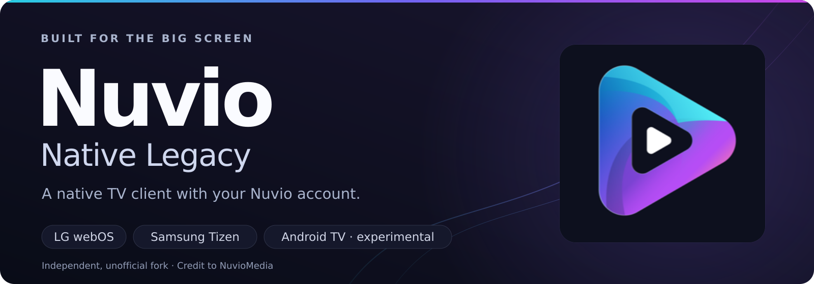
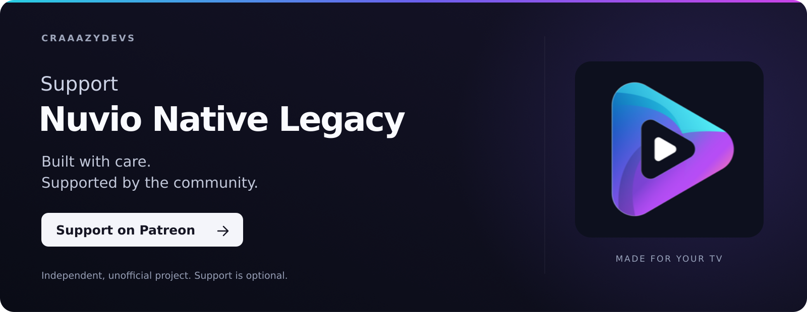

**Android TV and Mobile in one APK:** In Settings > Appearance, choose **Interface mode: TV / Mobile**. TV remains the default and keeps remote navigation. Mobile enables phone layouts, direct touch scrolling, portrait browsing, and the native keyboard; full-screen playback uses landscape. The choice is saved only on this device, and switching keeps the same app, account, and data. See [Android interface modes](docs/android/INTERFACE-MODES.md) for details.

<picture>
  <source media="(max-width: 640px)" srcset="docs/assets/nuvio-readme-banner-mobile.png">
  
</picture>

<p align="center">
  <a href="https://github.com/iqui27/nuvio-native-legacy/releases/latest"><strong>Download latest release</strong></a>
  &nbsp;·&nbsp; <a href="INSTALL.md">Install guide</a>
  &nbsp;·&nbsp; <a href="#reporting-a-problem">Report a problem</a>
  &nbsp;·&nbsp; <a href="https://discord.gg/9NWr6SHyzJ">Discord</a>
  &nbsp;·&nbsp; <a href="https://www.patreon.com/cw/CraaazyDevs"><strong>Support on Patreon ♥</strong></a>
</p>

I wanted Nuvio on my 2019 LG OLED (C9, webOS 4) and the web app was too heavy
for it. So I rewrote the TV client in C, on top of SDL2 and GLES2, talking to
the TV's own video pipeline. On the C9 the home screen runs at **60 fps with
zero janks**. The same code also runs **natively on Samsung Tizen** (TVs from
2018 on), builds for Samsung as WebAssembly, and there's an experimental
**Hisense VIDAA** build.

This is an **unofficial fork**. It's not affiliated with NuvioMedia, and all the
credit for Nuvio itself goes to them. It uses the same account, addons and
settings as the official app: sign in once and your stuff is there.

---

## Install

### LG webOS

The easiest way is the **Homebrew Channel**. Add this repository in the
channel's settings and the app shows up in the list, with updates:

```
https://github.com/iqui27/nuvio-native-legacy/releases/latest/download/repo.json
```

Or grab the `.ipk` from the [releases page](https://github.com/iqui27/nuvio-native-legacy/releases/latest).
Each release has two packages:

- `space.nuvio.native.legacy_X.Y.Z_arm.ipk`: the normal one. The texture budget
  follows the TV's RAM.
- `space.nuvio.native.legacy_X.Y.Z_arm-highcache.ipk`: a 300 MB texture cache,
  for TVs with 2 GB of RAM or more.

After the first install you don't need the PC anymore. When a new version is
out, the app shows a card with the release notes and **Update now**, and it
installs through the Homebrew Channel right on the TV.

Developer Mode (`ares-install`) works too; the steps are in [INSTALL.md](INSTALL.md).

### Samsung Tizen

Two builds, both on every release. Install either with
[Apps2Samsung](https://github.com/Apps2Samsung/Apps2Samsung), which signs the
package for your TV's DUID (packages ship **unsigned** on purpose: a
distributor certificate would lock the install to a fixed list of TVs).

#### Native `.tpk` (recommended if your TV is listed)

The same C app as on LG, running directly on the TV (OpenGL ES, no web engine
underneath). Pick the file for your TV:

| TV (year) | Tizen | File |
|---|---|---|
| 2018–2020 | 4.0 – 5.5 | `Nuvio-X.Y.Z-NuvioTpk40.tpk` |
| 2021 | 6.0 | `Nuvio-X.Y.Z-NuvioTpk60.tpk` |
| 2022–2023 | 6.5 – 7 | `Nuvio-X.Y.Z-NuvioTpk65.tpk` |
| 2024+ | 8 – 9 | `Nuvio-X.Y.Z-NuvioTpk.tpk` |

Not sure which Tizen you have? Apps2Samsung shows it when it connects.

- **Updates itself** (new in 1.5.4, so the first real run is the next
  release): when a new release is out, the app
  downloads the new native library, checks its SHA-256 against the release and
  switches to it on the next launch — no reinstall. If a release changes the
  app shell itself, the notes will say to reinstall. (Coming from a preview or
  test build? Install 1.5.4 once by hand.)
- On 2018–2020 sets the TV blocks native code loaded from the app folder, so
  the app loads it straight into memory instead. A normal (Public) certificate
  is enough; no Partner certificate needed.
- Settings › Advanced › **Visual effects**: *Automatic* measures the TV in the
  first seconds and turns off the heaviest effects if it can't keep up; you can
  force *Full* or *Light*.
- Samsung TVs don't support Dolby Vision; the player labels the source's HDR
  type instead (HDR10, HDR10+, HDR).

#### WebAssembly `.wgt`

`NuvioTV-X.Y.Z-tizen.wgt`, for Tizen **5.5 or newer**. The same app compiled to
WebAssembly, running in the TV's web engine. Samsung doesn't let a web app
install itself, so here the update card only tells you there's a new version.
Tizen 4 doesn't run the `.wgt` (#96) — use the native `NuvioTpk40` instead.

Follow the Samsung work in the
**[Samsung native project board](https://github.com/users/iqui27/projects/2)**
and [issue #137](https://github.com/iqui27/nuvio-native-legacy/issues/137).

### Hisense VIDAA (experimental)

VIDAA apps are hosted pages, not packages. Bookmark
`https://nuvio-recomendacoes.henriquef29.workers.dev/tv/` in the TV browser, or
sideload it in developer mode with `tools/vidaa-instalar/instalar.py` (see
`tools/vidaa-instalar/LEIAME.md`). It picks a multithreaded build when the
browser supports SharedArrayBuffer and falls back to single-threaded otherwise.
**Nobody has run it on a real VIDAA TV yet**, so reports are very welcome.
Known limits: no Dolby Vision in MP4, no AV1, no plain-HTTP video from the
HTTPS page, and YouTube trailers only in the single-threaded build.

---

## Which TVs

| TV | Status |
|---|---|
| LG webOS 4.x | **Measured** on my C9. This is where I develop. |
| LG webOS 5+ | **Works**, reported by users (2020 CX up to 2024 B4). I don't have one. |
| LG webOS 3.x | **Works**, reported by testers (webOS 3.4.3). Same package as everyone else. I don't have one. |
| LG webOS 2.x | Loads according to firmware symbol dumps. Never run. |
| Samsung Tizen 8/9 (native .tpk) | **Works**, confirmed on three 2023–2024 sets. |
| Samsung Tizen 6.5/7 (native .tpk) | Should work (same code as 6.0 and 8/9); few reports yet. |
| Samsung Tizen 6.0 (native .tpk) | **Works**, confirmed. |
| Samsung Tizen 4.0/5.0 (native .tpk) | **Works**, confirmed on two 4.0 and two 5.0 sets (2018–2019). |
| Samsung Tizen 5.5+ (WebAssembly) | **Works**, many users. |
| Samsung Tizen 4 (WebAssembly) | No (#96) — use the native `.tpk`. |
| Hisense VIDAA | Experimental, untested. |

On webOS 3, keep in mind that many of those sets can't decode H.265 or HDR, and
have little free RAM (around 300 MB), so pick H.264 sources when you can.

About root on LG: the app itself doesn't run as root, and installing through
the Homebrew Channel doesn't need it. What I haven't been able to measure is
video on a TV **without** root, because the app talks straight to the TV's media
service. If you have a non-rooted TV and video is a black screen while the UI
works, please tell me.

---

## What it does

**Account and profiles**
- QR sign-in on the TV; the session survives reboots
- Profiles with PIN; each profile has its own addons, home order, Continue
  Watching and progress
- Trakt and Simkl linked from the TV, **per profile**
- Addons, home catalog order, collections, library, watched items and settings
  come from your Nuvio account

**Home**
- Hero with trailers (Apple TV first, then YouTube), logos and backdrops from
  several sources (TMDB, metahub, Apple TV, fanart.tv, anime sources)
- Continue Watching, Trakt rows, collections, director pages, an Explore page
- Opens from a local cache in about a second, then updates from the network
- Magic Remote pointer on LG

**Playback**
- The TV's own video pipeline: HDR10, Dolby Vision on MP4, Atmos passthrough
  where the TV supports it
- Sources from your addons, with debrid (Real-Debrid, TorBox, Premiumize).
  Uncached TorBox torrents can be sent to download from the Sources sheet
- Automatic source: **Best source** or **First in list** (like Nuvio's auto-play
  first source), checked one at a time, with a limited number of retries
- **ASS/SSA subtitles** embedded in MKV (anime) drawn by the app with libass, read
  in the background over HTTP ranges while the video plays
- Addon subtitles, preferred subtitle/audio language that turns on by itself,
  subtitle style
- Up Next / More like this at the credits (MKV chapters and TheIntroDB), skip
  intro, resume
- Seek shows only the progress bar when the controls are hidden

**Also**
- Live TV (Xtream and Stalker portals) with a guide
- Blur unwatched episodes (spoiler protection)
- Recommend a title to a friend
- A **Diagnostic** that measures your TV and tunes the app for it (below)

What it doesn't do yet: Nuvio **plugins** (JavaScript scrapers). This app runs
Stremio addons, but it has no JavaScript engine for plugins (#134).

---

## The Diagnostic, and why I ask you to run it

Almost everything that made this app faster came from real logs, and I only own
one TV. So there's a **Diagnostic** in **Settings › Diagnostics › Diagnostics
and optimization**. It takes about a minute. It measures your TV (addons,
sources, every artwork source, memory, frame times), picks the best settings
for it, checks before and after, and keeps the new profile only if it's clearly
better than network noise.

Then it sends an anonymous report: timings and sizes. **No passwords, tokens,
addon URLs or personal lists.** Each report tells me the right memory budget,
network threads and image sizes for another TV model.

---

## Support development

<a href="https://www.patreon.com/cw/CraaazyDevs">
  <picture>
    <source media="(max-width: 640px)" srcset="docs/assets/patreon-support-banner-mobile.png">
    
  </picture>
</a>

This project grew out of wanting a smooth, be
